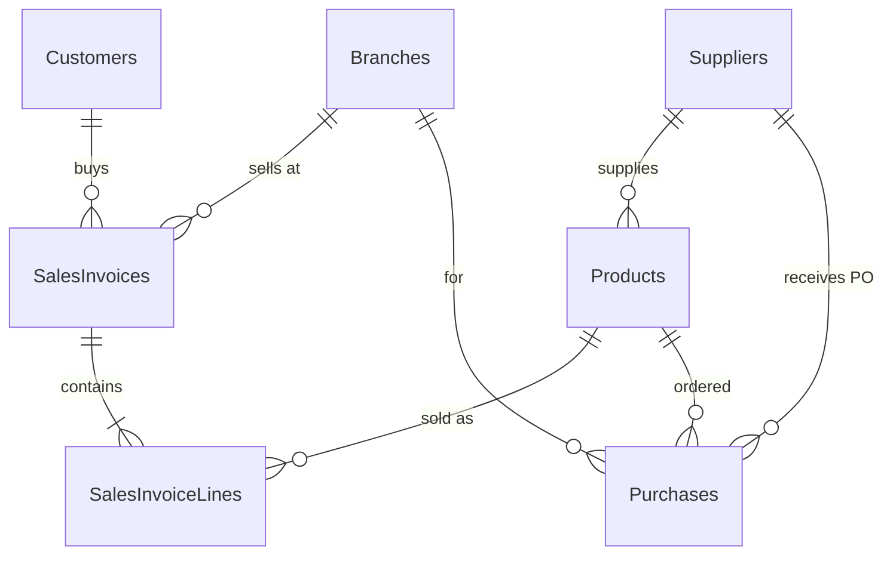

# Sales & Customer Performance Analysis — SQL Server

Analysis of 3 years (2023–2025) of sales for a fictional 5-branch Saudi electronics & household retail chain, done in **T-SQL** on **Microsoft SQL Server**: 100K invoices, 210K invoice lines, 4.2K active customers, 60 products.

> **About the data:** the dataset is **synthetic**. I wrote a generator ([`data_generator/generate_erp_data.py`](../data_generator/generate_erp_data.py)) that simulates an ERP system day by day: seasonality, a new branch, stock-outs, supplier delays and customer churn. The tables follow an ERP design (invoice header/lines, purchases, master data), like the ERP systems I build professionally. The generator sets how customers and products behave, not the results: every number below comes from running the SQL queries.

---

## Business questions

1. How is the business growing, and where does the growth come from?
2. Which branches, categories and products drive revenue **and** profit?
3. How concentrated is revenue among customers (Pareto 80/20)? Which customers are at risk?
4. When are the strongest seasons and days?
5. What explains the unusual drop in December 2025?

## Data model



All analysis runs on one view, [`vw_SalesLines`](sql/03_views.sql), which joins the lines to their invoice, branch, customer and product, so the join logic is written only once.

## SQL techniques used

| Technique | Where |
|---|---|
| CTEs (including chained CTEs) | every query |
| `LAG` for MoM / YoY growth | Q01, Q02, Q03 |
| Running totals (`SUM() OVER (... ROWS UNBOUNDED PRECEDING)`) for YTD and Pareto | Q02, Q08 |
| Moving average (`ROWS BETWEEN 2 PRECEDING`) | Q02 |
| `RANK`, `DENSE_RANK`, `ROW_NUMBER` (top-N per group) | Q03, Q05, Q06, Q12 |
| `NTILE` scoring for RFM segmentation | Q15 |
| Share of total (`SUM(SUM(x)) OVER ()`) | Q04, Q08, Q10 |
| Conditional aggregation (`SUM(CASE ...)`) | Q07, Q18, Q19 |
| Self-join on year (retention), `CROSS APPLY` | Q05, Q14, Q17 |
| Indexes to support date scans and joins | [`01_create_database.sql`](sql/01_create_database.sql) |

---

## Key findings

**1. Growth is slowing, and in 2025 it came only from the new branch.**
Revenue grew from SAR 25.8M (2023) to 29.6M (+14.7%) and then 32.4M (+9.4%), with gross margin steady at about 22.3%. Without the Makkah branch (opened July 2024), the four existing branches **fell 1.7%** in 2025 (28.08M → 27.60M). Riyadh was the only existing branch with real growth (+5.9%). *(Q01, Q03)*

**2. Dammam lost 19% of its revenue in 2025.** The decline begins in February 2025 and continues all year. The other branches did not fall, so the cause is local (for example a new competitor nearby), not a company-wide problem. *(Q03)*

**3. Computers bring in revenue but little profit.** Computers are 24.8% of revenue but only 17.7% of gross profit (15.9% margin). Kitchenware, Personal Care and Stationery together are 13.1% of revenue but **20.1% of profit** (32–39% margins). AirPods earn a 52.8% margin, the highest in the top 10. *(Q04, Q05)*

**4. Five products almost stopped selling in 2025** (units down 78–86%): iPhone 13, Dell Inspiron 14 (2022), HP LaserJet M111, Stand Mixer, Drawing Kit. These are older models that newer ones replaced, and they are candidates for clearance before their stock loses more value. *(Q07)*

**5. Revenue is concentrated in a small group of customers.** 29% of customers (1,237) generate 80% of revenue. Corporate and wholesale accounts are 14% of customers and bring in 37.6% of revenue. No single customer is above 0.7%, so the business does not depend on any one account. *(Q08, Q09, Q10)*

**6. SAR 10.3M came from customers who are now inactive.** RFM segmentation flags 618 "At Risk" customers. They used to buy often (19 invoices on average) but have not bought for about 324 days, and together they account for 11.7% of all-time revenue. *(Q15)*

**7. Three clear seasonal peaks, and the weekend matters.** November is the strongest month (index 131, White Friday: mobiles +45%), then August (116, back-to-school: stationery ×2.2, computers +43%), then Ramadan (kitchenware +62% in March). Friday sales are 32% above an average day and Thursday 21% above. *(Q11, Q12, Q13)*

**8. Deep discounts remove most of the margin.** Lines sold at 15–20% off earn 7–13% gross margin, compared with 26% at full price. *(Q16)*

**9. The December 2025 drop (−7.9% YoY) came from supply, not demand.** Mobiles fell 17% compared with December 2024. In the same month the mobiles supplier's lead time went from 6 to 25 days, with 36 purchase orders still unreceived at year end. The home-appliance supplier was also delayed (10 → 23 days). *(Q18, Q19)*

**10. The Makkah branch is ramping up as expected.** It opened at 34% of an average branch's monthly revenue, and from its 9th month it reached 70–80% in most months. *(Q17)*

## Recommendations

| # | Recommendation | Based on |
|---|---|---|
| 1 | Report **like-for-like growth** (existing branches only) next to total growth, so a new branch does not hide a flat core business | F1 |
| 2 | Investigate Dammam (competitors, staffing, stock availability) and set a recovery plan with monthly tracking | F2 |
| 3 | Sell accessories alongside every phone and laptop (case, charger, AirPods, mouse). They raise the margin on each basket | F3 |
| 4 | Clear the 5 declining SKUs through bundles or outlet pricing, and stop reordering them | F4 |
| 5 | Give the top 1,237 customers and the B2B accounts dedicated account management | F5 |
| 6 | Run a win-back campaign for the 618 "At Risk" customers. These customers averaged about SAR 3.4M a year, so winning back 10% of them would recover roughly SAR 0.3M a year | F6 |
| 7 | Plan stock and staffing around November, August and Ramadan, and schedule campaigns for Thursday and Friday | F7 |
| 8 | Limit discounts above 10% to planned events, and require approval above that level | F8 |
| 9 | Add a second mobiles supplier and hold safety stock before December | F9 |

---

## Project structure

```
01-sql-sales-analysis/
├── data/                  CSV exports of the ERP tables
├── sql/
│   ├── 01_create_database.sql   schema, keys, constraints, indexes
│   ├── 02_load_data.sql         BULK INSERT of the CSV files
│   ├── 03_views.sql             analytical view vw_SalesLines
│   └── 04_analysis.sql          19 analysis queries (Q01–Q19)
├── results/               output of each query (CSV) + all_results.md
└── run_analysis.py        runs every query and saves the results
```

## How to run

Run from **Command Prompt (cmd)**. PowerShell strips the quotes around the `-v` value.

```bat
REM 1. (optional) regenerate the data
python ../data_generator/generate_erp_data.py

REM 2. create the database and load the data (change the server name if needed)
sqlcmd -S .\SQLEXPRESS -E -C -i sql/01_create_database.sql
sqlcmd -S .\SQLEXPRESS -E -C -i sql/02_load_data.sql -v DataPath="<full path to the data folder>"
sqlcmd -S .\SQLEXPRESS -E -C -i sql/03_views.sql

REM 3. run the analysis in SSMS (04_analysis.sql), or save every result at once:
python run_analysis.py .\SQLEXPRESS
```
